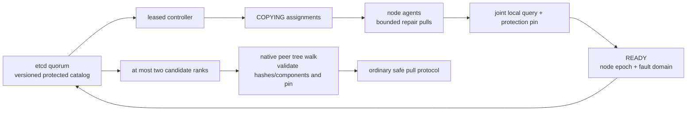
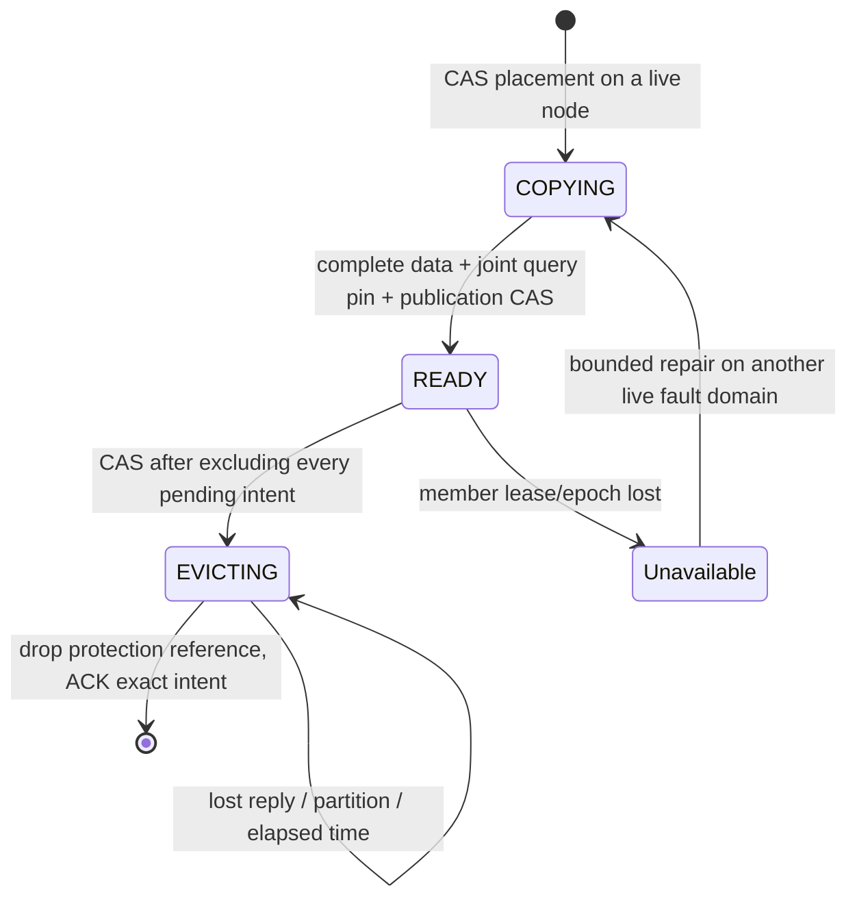

# Resilient shared CPU cache and protected prefixes

This implementation retains RadixShmem's ownership of the CPU SlotStore. FlexKV
continues planning H2D/D2H transfers against that pool. A peer-pull failure is a
cache miss; it is never permission to recycle a buffer still used by a backend.
The protected-prefix feature is **opt-in** and limited to a small manual set.

## Pull ownership protocol (A)

```mermaid
sequenceDiagram
    participant C as FlexKV / RadixClient
    participant S as radix-server
    participant T as transfer backend
    C->>S: Reserve(epoch, session, sequence, exact-key, bytes)
    S-->>C: RESERVED or FOLLOWING or refused
    C->>S: Hold (owner only)
    S-->>C: HELD (credit no longer expires)
    Note over C: Query and pin source; allocate staging
    C->>S: Submit(same identity, immutable descriptors)
    S->>T: Read (each component consumes one batch credit)
    Note over C,T: Caller deadline / cancellation does not release ownership
    T-->>S: Terminal status, then release succeeds
    C->>S: Query (retryable)
    S-->>C: DONE (repeatable until ACK)
    Note over C: Publish or recycle; release source pin
    C->>S: ACK
    S-->>C: RETIRED; credits returned
```

`Describe` advertises `pull_protocol=2` and a random server `epoch`. A session
uses increasing operation numbers. The server retains each session's high-water
mark for its entire epoch, so a delayed retry cannot recreate an acknowledged
operation. Reusing an operation with different bytes/descriptors is rejected.
An unknown operation or changed epoch is **not** proof of completion.

Reserve and Hold are separate intentionally. An unused reservation can expire
before any pins exist. After Hold, credits cannot expire: even a dead client may
still own source references or staging slots. An ambiguous Hold response is
acknowledged without querying or staging. An ambiguous Submit is retried with
the same identity; status/result delivery and ACK may also be retried.

Exact-key singleflight lives at the server, before pin/staging, and therefore
covers multiple processes. The key includes the full namespace-derived hash
sequence and component mask. Followers do not allocate staging. They wait for
the owner's publication ACK, then perform their own local query/pin. Cancelling
one consumer does not cancel a transfer used by another. Different SWA boundaries
or masks are different operations.

Limits are per node: `--max-reserved-bytes` (staging budget; defaults to data
budget), `--max-pending-jobs`, and `--max-inflight` (backend component batches).
Cancelled/draining, DONE-but-unacknowledged and quarantined jobs retain credits.
`--max-sessions` bounds retained session tombstones; exhaustion fails admission
closed until a controlled epoch restart. This is not an indefinitely renewable
session service. Source pin coverage can exceed requested blocks because the
native tree pins whole compressed nodes; the staging budget does not claim to
be a separate global remote-pin-byte budget.

New clients fall back locally against an older server. New servers reject legacy
wire Submit rather than allowing its ambiguous-completion semantics. Upgrade
server and client together to retain remote reuse. Direct native/C++ attachments
must still follow their explicit lifetime contract; the Python session barrier
cannot account for an unregistered native user.

## Drain and crash boundary

`PullJob.resources_released` describes transfer resource completion, independent
of logical cancellation. `close(timeout_s=...)` stops admission and drains.
A timeout retains the RPC channel, mappings, pins and transfer engine; retry
close after resolving the cause. A server additionally waits for Python client
sessions to close. Stop/drain FlexKV H2D/D2H users before closing their client.
Returned query/result references must be finalized before client close.

The CLI continues draining after SIGTERM instead of forcing reclamation on a
timer. An operator's SIGKILL is outside this protocol. An unclean server leaves
`/dev/shm/<name>.owner` with its epoch; another server refuses to replace that
pool. After stopping old clients and establishing that old DMA cannot access the
pool, an operator can clear that marker and rebuild/restart the affected workers.
The code does not automatically clear shared locks, reader counts or dirty
markers. This is conservative restart, not transparent recovery of a dead pool.

## Protected-prefix directory and replicas (B)

For this first version, the protected set uses a **small external directory on
etcd**, independent of RHT. Ordinary prefixes retain the existing RHT path.
This chooses the document's B2 alternative for the manual set; it does not
implement full ordinary-prefix RHT snapshot/log replay or standby RHT holders.
A three-member etcd quorum must be deployed separately for control-plane HA.



Every node runs an agent. A leased leader key selects the repair controller.
Each metadata update compares the object version and membership witnesses in
one etcd transaction; controller updates also compare the exact leader token.
A stale controller cannot commit after leadership changes. Object records
survive leader restart. The manual manifest is capped at 32 objects, each at
most 8192 block hashes. This is not a full-cache metadata backend.

READY requires a successful local **joint component query for the entire
prefix**, with its native pin retained. Pin accounting uses native full/SWA/
Mamba pin coverage, including compressed-node tails, conservatively charging
shared coverage more than once. Pin before publish; retain the pin if publish
ACK is ambiguous. A missing component, stale epoch, COPYING assignment or
EVICTING record does not count as a replica.



The replica floor is two distinct fault domains. An ordinary eviction request
is allowed only when two other READY domains remain after all pending intents
are excluded. Dropping the protection reference only permits normal LRU to
reclaim after remaining readers release their native references. There is no
TTL transition from EVICTING back to READY. Control-plane failure refuses new
permissions and keeps existing pins.

Each agent performs at most one repair pull at a time. Copy starts are paced by
`bytes / repair_bytes_per_s`, permitting one-object bursts; this is an average
pacing budget, not a NIC instantaneous bandwidth shaper. After one data-node
failure, two replicas may become one; the controller repairs onto another live
domain. This does not guarantee survival of two concurrent domain failures.

## Enabling and observing

Keep existing cluster/index/NIC options and add, for example:

```sh
radix-server --name /flexkv --data-bytes 64G \
  --expected-min-nodes 3 --registry etcd://etcd1:2379,etcd2:2379,etcd3:2379 \
  --cluster-id inference --node-name node-a --rpc-address 10.0.0.11 \
  --max-reserved-bytes 8G --max-inflight 64 \
  --protection-file protected-prefixes.json --fault-domain rack-a \
  --protected-bytes 4G --repair-bytes-per-s 64M \
  --metrics-port 9108
```

Use a different fault domain only for genuinely independent hosts/racks. Every
agent uses the same manual prefix file:

```json
[{"identity":"model-revision/layout/tenant-namespace", "hashes":[101,102], "mask":1}]
```

The numbers above are illustrative. Export the **actual FlexKV SequenceMeta
block hashes**, retaining model/layout/tenant namespace, tokens-per-block and
FULL/SWA common boundary. Do not hash prompt text again using a different
algorithm. `identity` namespaces the catalog; it does not inject missing model
identity into existing tree hashes. Deployments must enforce the existing shared
pool and hash-namespace compatibility contract. The seed prefix must already
exist completely on at least one node; this service cannot regenerate absent KV.

Metrics bind to `127.0.0.1` by default. Configure `--metrics-host` explicitly for
a scrape network. `/metrics` has fixed names and no prompt/tenant/op-id labels:

| Metric | Operational meaning |
|---|---|
| `radixshmem_reserved_bytes` | node staging credits including held/draining/unacknowledged work |
| `radixshmem_oldest_operation_seconds` | age of the oldest owned operation |
| `radixshmem_release_pending_batches` | terminal batches whose backend has not released ownership |
| `radixshmem_admission_refused_total` | node admission pressure |
| `radixshmem_transfer_bytes_total` | backend-reported transferred bytes, not GPU-consumed bytes |
| `radixshmem_protected_healthy` / `protected_objects` | protected objects currently meeting the replica floor |
| `radixshmem_attached_clients` | sessions that block clean server teardown |

Import [`monitoring/shared-cache.json`](monitoring/shared-cache.json) into
Grafana and select the Prometheus datasource. Its nine panels use actual
ownership, transfer and verified-hit counters. No inferred GPU consumption or
acceptance-normalized throughput is plotted.

`/ready` returns separate `local`, `remote`, `protected` booleans. HTTP 200 means
local service readiness; it does not mean protected redundancy is healthy.
Client `transfer_stats()` also reports RPC errors, quarantine count and oldest
pending age. FlexKV reports peer hits after final local validation; GPU
consumption still requires the existing H2D/framework completion path.

Suggested alerts: sustained oldest-operation growth together with release-pending
batches; reserved bytes near the configured limit; attached sessions after a
scheduled drain; protected_healthy below protected_objects. Thresholds must be
chosen against the actual workload and recovery objective, not copied as SLAs.

## Validation and boundaries

Regression coverage includes operation replay/retirement, lost Submit/status/ACK
responses, drain timeouts, pre-query admission, per-component concurrency,
node-wide duplicate pulls, concurrent eviction intents, stale epochs, incomplete
components, control-plane partitions, controller fencing, and a real etcd
transaction test. The native repair test uses real CPU SlotStores and pins plus
a memcpy backend and checks byte equality after repair.

These tests do not establish RDMA NIC abort/fence behavior, GPU H2D/D2H output
correctness, multi-host RHT-holder recovery performance, or production RTO/TTFT.
Before rollout, run matched workloads on the target GPU/NIC topology, inject a
holder failure, one data-node failure, client death, RPC loss and etcd quorum
loss, and verify output equality plus resource drain. Preserve raw TTFT/TPOT,
QPS, hit/transfer/consumption counters and recovery windows separately.
